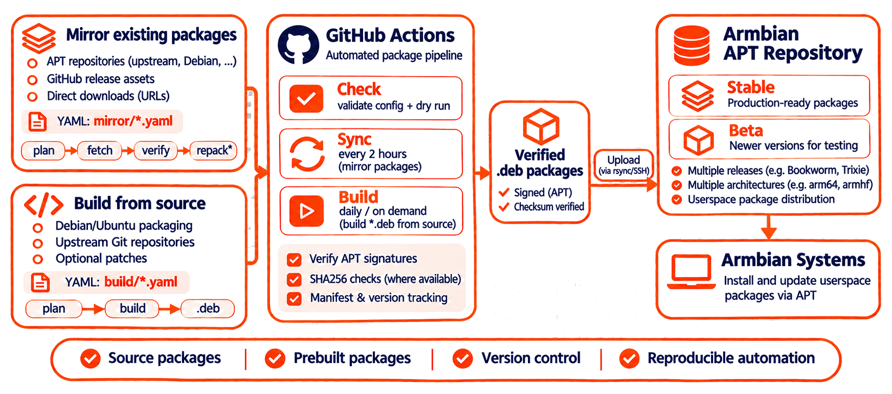

<h2 align="center">
  <a href=#></a>
  <br><br>
</h2>

# Armbian external packages

## Purpose of This Repository

Third-party Debian packages for the Armbian apt repository: VS Code, Chromium, Firefox, ZFS, Raspberry Pi userspace, mesa and more. This repository holds the package list, the upstream signing keys and the tool that downloads, builds, checks and sorts the packages; the Armbian repository update takes the result and publishes it.

Package list with versions per release and architecture: <https://external.armbian.com/>



## Layout

```
mirror/<name>.yaml        built packages to download: apt repository, GitHub release, URL
keys/                     upstream signing keys (binary .gpg)
extpkg/                   the tool (Python package, invoked as `python3 -m extpkg`)
tests/                    unit tests (unittest)
tools/                    helper scripts (compare-incoming, import-os)
docs/                     technical documentation
```

Build configs live under a `build/` directory at the repository root (see [CONTRIBUTING.md](CONTRIBUTING.md) and [docs/technical.md](docs/technical.md)).

## What it produces

```
debs-beta/extra/<release>-<target>/   every package, for the beta repository
debs/extra/<release>-<target>/        packages newer than the published stable version
manifest.json                         source, version and SHA256 of each file
```

A config can limit itself to one repository with `repositories: [beta]`.

## Built with

- Python 3 for the `extpkg` tool, the helpers in `tools/` and the tests.
- YAML for package configs under `mirror/` (and `build/`) and for the GitHub Actions workflows.
- Standard Debian tooling invoked by the tool and the workflows: `gpgv`, `dpkg-deb`, `dpkg-dev`, `fakeroot`, `apt-get`, `rsync`, `ssh`, `patch`, `xz-utils`.
- The archive keyrings `debian-archive-keyring` and `ubuntu-keyring` for dependency checks.

## Quick start

```sh
python3 -m extpkg validate                                 # check all configs
python3 -m extpkg run --dry-run --only gh                  # download and check one package, no upload
python3 -m extpkg plan --configs build --only fastfetch    # resolve the sources of one build
```

Run the unit tests:

```sh
python3 -m unittest discover -s tests -t .
```

A build runs in a container of the target release. See [docs/technical.md](docs/technical.md#test-a-build-locally).

## Add a package

Read [CONTRIBUTING.md](CONTRIBUTING.md). With Claude Code, run the `add-external-package` skill (see [.claude/skills/add-external-package/SKILL.md](.claude/skills/add-external-package/SKILL.md)).

Short rules:

- Choose the first source that works: apt repository with signed `InRelease`, then GitHub release with `.deb` assets, then direct URL.
- Do not add a signing key that you did not verify against a second source.
- Do not turn off `verify.signature` or `verify.checksums`.
- Open a pull request. The Check workflow validates the config and does a dry-run download.

## Continuous integration

Workflow runs, schedules and status for this repository are listed on the Armbian CI overview:

<https://actions.armbian.com/?repo=external>

Dry run is the default everywhere. Scheduled Sync runs upload only when the upload secrets are set; scheduled Build runs upload only when the repository variable `BUILD_LIVE` is `true`. Pull requests never upload.

## More

- [CONTRIBUTING.md](CONTRIBUTING.md): how to add a package, step by step.
- [docs/technical.md](docs/technical.md): checks, config reference, builds, state, variables and secrets.
- [CLAUDE.md](CLAUDE.md): instructions for AI-assisted contributions.
- Armbian documentation: <https://docs.armbian.com/>
- Armbian project: <https://www.armbian.com/>
